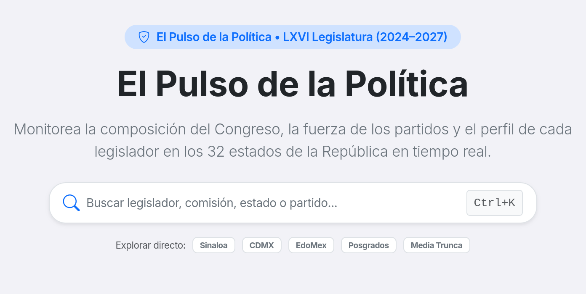

# 🇲🇽 Pulso Cívico — Guía y Documentación del Proyecto
<p align="center">
  
</p>

<p align="center">
  <a href="https://www.php.net/"></a>
  <a href="docs/STACK_TECNOLOGICO.md"></a>
  <a href="https://www.sqlite.org/"></a>
  <a href="storage/data/json/"></a>
  <a href="https://developer.mozilla.org/es/docs/Web/JavaScript"></a>
  <a href="https://getbootstrap.com/"></a>
  <a href="https://developer.mozilla.org/es/docs/Web/HTML"></a>
  <a href="https://www.python.org/"></a>
  <a href="LICENSE"></a>
  <a href="CONTRIBUTING.md"></a>
</p>

<p align="center">
  
</p>

> **Plataforma ciudadana, neutral y de código abierto para la transparencia política en México.**

Cruzamos **datos oficiales del gobierno** con **noticias** para mostrar el historial real de cada representante popular: qué iniciativas presentan, cómo votan en el pleno, su trayectoria partidista y el fenómeno del "chapulineo" (cambio de partido). 

**Objetivo único:** Facilitar un **voto informado y consciente**.

> [!TIP]
> **¿Eres periodista, investigador o ciudadano y quieres aportar datos sin saber programar?**  
> No necesitas saber Git ni código para colaborar. Consulta la guía rápida y canales de envío (incluso anónimos) en **[docs/PIPELINE_STAGING.md](docs/PIPELINE_STAGING.md)**.

---

## 📌 ¿Qué es lo relevante de este proyecto?

1. **Impacto Cívico Directo:**
   - En México, la información de los políticos suele estar oculta en gacetas en PDF o portales legislativos confusos.
   - Pulso Cívico centraliza el historial legislativo para que cualquier ciudadano audite a sus diputados y senadores en segundos.
2. **Neutralidad Absoluta y Verificabilidad:**
   - **Regla de oro:** Todo dato mostrado debe tener un enlace directo a una fuente oficial (`.gob.mx`) o nota periodística verificada con hash criptográfico SHA-256.
   - Cero opiniones, cero adjetivos, cero propaganda partidista.
3. **Arquitectura Low-Cost y de Fácil Acceso:**
   - **Cero frameworks pesados** (sin Laravel, sin Symfony).
   - **Bases de datos ágiles e híbridas (SQL / JSON):** Cero configuración local gracias a SQLite (`storage/database.sqlite`) o MySQL en producción, conviviendo con datasets JSON versionados en `storage/data/json/`.
   - **Cero herramientas de compilación frontend** (Bootstrap 5 vía CDN y JavaScript Vanilla nativo).
   - Cualquier persona puede correrlo en su computadora en 2 minutos.
4. **Grafo Cívico Interconectado (Todo es un hipervínculo):**
   - En lugar de un directorio estático, modela a los actores políticos como una red navegable a través del tiempo.
   - **Persona Invariante vs. Mandatos Temporales:** La identidad del político trasciende legislaturas. Desacoplar a la persona de sus cargos permite auditar suplencias, dinastías y cambios de partido a lo largo de los años ("detector de chapulines").
   - **Hipervínculos Bidireccionales:** Políticos, mandatos, partidos, comisiones, entidades y votaciones están enlazados entre sí.

---

## 🧭 ¿Qué hay hoy y qué es lo que falta?
<p align="center">
  
</p>

### ✅ Lo que ya está construido:
- **Cámara de Diputados Federal (LXVI Legislatura 2024–2027):** 500 perfiles con foto, comisiones, suplentes y trayectoria.
- **Votaciones y Asistencias:** Votaciones nominales y registro de asistencias al pleno.
- **Histórico Federal (LXI a LXV Legislaturas):** Datasets históricos del Congreso de la Unión.
- **Congresos Estatales Iniciales:** Datasets de Baja California, Baja California Sur, Durango, Coahuila, Nuevo León, Quintana Roo, Sinaloa, Sonora, Tamaulipas y Yucatán.
- **Interfaz Web:** Buscador global (`Ctrl+K`), mapa interactivo por entidad, fichas de perfil de políticos, explorador por comisiones y estudios estadísticos.

### 🚧 Lo que falta (¡Dónde se necesita más ayuda!):
1. **Congresos Estatales Pendientes (22 estados):**
   - Faltan scrapers y datos de estados clave como: **CDMX, Jalisco, Estado de México, Puebla, Guanajuato, Veracruz, Michoacán, Oaxaca, Chihuahua, Chiapas, Aguascalientes, Querétaro**, entre otros.
   - Ver el avance detallado en [docs/FUENTES_Y_COBERTURA.md](docs/FUENTES_Y_COBERTURA.md).
2. **Senado de la República:**
   - El portal hoy cuenta con Cámara de Diputados federal y congresos locales; falta incorporar la Cámara de Senadores (perfiles, votaciones y asistencias).
3. **Trazabilidad Histórica y UI:**
   - Conmutador visual de pastillas por legislatura en [views/politico.php](views/politico.php) para alternar entre mandatos (ej. ver cómo votó en la LXIV vs LXVI legislatura).
4. **Módulo de Noticias y Hechos:**
   - Vincular notas periodísticas de fuentes acreditadas a votaciones polémicas o cambios de bancada.
5. **Calidad de Código y Limpieza:**
   - Dividir clases grandes (>400 líneas) como `DataService.php` o `SilIngestService.php`.
   - Estandarizar una `ScraperInterface` común para facilitar la creación de scrapers.

---

## 🎯 ¿En qué puedes ayudar según tu perfil?

| Tu Perfil | Tareas Recomendadas | Guías de Referencia |
|---|---|---|
| **Programador PHP / Python** | Crear scrapers para congresos estatales faltantes, estandarizar servicios o añadir tests. | [docs/COMO_CREAR_UN_SCRAPER.md](docs/COMO_CREAR_UN_SCRAPER.md) y [docs/ARQUITECTURA.md](docs/ARQUITECTURA.md) |
| **Frontend / Diseñador** | Mejorar la experiencia móvil (*mobile-first*), diseño de tarjetas de legisladores, accesibilidad y visualizaciones interactivas. | [views/](views/) y [docs/backlog/ISSUE_02_FRONTEND_CONMUTADOR_LEGISLATURAS.md](docs/backlog/ISSUE_02_FRONTEND_CONMUTADOR_LEGISLATURAS.md) |
| **Investigador / Periodista** | Aportar gacetas, actas, verificar fuentes o enviar datos sin programar (incluso de forma anónima). | [docs/PIPELINE_STAGING.md](docs/PIPELINE_STAGING.md) y [docs/FUENTES_Y_COBERTURA.md](docs/FUENTES_Y_COBERTURA.md) |
| **Principiante / Estudiante** | Resolver tareas `good first issue`, documentar, reportar inconsistencias o agregar datos asistido por IA. | [AGENTS.md](AGENTS.md) y [docs/DICCIONARIO_DE_DATOS.md](docs/DICCIONARIO_DE_DATOS.md) |

---

## ⚡ Instalación y Puesta en Marcha Local

### 1. Requisitos previos
- **PHP 8.1 o superior** con extensiones `curl`, `mbstring` y `json`.
- **Git**.

#### En Linux (Ubuntu / Debian / Mint / WSL):
```bash
# Instalar PHP y las extensiones necesarias
sudo apt update
sudo apt install -y php-cli php-curl php-mbstring php-xml
```

#### En Windows:
- Puedes usar **XAMPP** (colocando la carpeta dentro de `C:\xampp\htdocs\pulso-civico`) o instalar PHP standalone.

---

### 2. Configuración y ejecución en 3 pasos:

```bash
# 1. Copiar archivo de entorno
cp .env.example .env

# 2. Iniciar el servidor local de PHP
php -S localhost:8000
```

Abre tu navegador en: [http://localhost:8000](http://localhost:8000)

---

## 🍴 Guía Paso a Paso: Cómo hacer Fork y trabajar en tu propia rama

Para colaborar con tus propios cambios sin alterar el repositorio principal directamente, se utiliza el flujo estándar de **Fork & Pull Request**:

```
[Repositorio Oficial (upstream)] ──(Fork en GitHub)──> [Tu Fork en GitHub (origin)]
             │                                                        │
             │ (git fetch / pull)                                     │ (git push)
             ▼                                                        ▲
  [Tu Copia Local (rama main)] ──(git checkout -b)──> [Tu Rama de Trabajo (feat/...)]
```

### Paso 1: Crear tu Fork en GitHub
1. Ve a [https://github.com/elpulsocivico/pulso-civico](https://github.com/elpulsocivico/pulso-civico).
2. Haz clic en el botón superior derecho **"Fork"**.
3. Confirma la creación en tu cuenta personal (quedará como `https://github.com/<tu-usuario>/pulso-civico`).

---

### Paso 2: Conectar este repositorio local a tu Fork

En tu terminal local dentro de este proyecto:

```bash
# 1. Renombra el repositorio principal como 'upstream' (fuente original)
git remote rename origin upstream

# 2. Agrega tu Fork personal como 'origin' (reemplaza <tu-usuario> con tu usuario de GitHub)
git remote add origin https://github.com/<tu-usuario>/pulso-civico.git

# 3. Verifica que ambos remotos estén configurados correctamente:
git remote -v
```

Deberás ver algo similar a esto:
```text
origin    https://github.com/<tu-usuario>/pulso-civico.git (fetch)
origin    https://github.com/<tu-usuario>/pulso-civico.git (push)
upstream  https://github.com/elpulsocivico/pulso-civico.git (fetch)
upstream  https://github.com/elpulsocivico/pulso-civico.git (push)
```

---

### Paso 3: Crear tu rama de trabajo

**Nunca trabajes directamente en `main`**. Crea siempre una rama temática:

```bash
# Asegúrate de partir de main actualizado
git checkout main
git fetch upstream
git merge upstream/main

# Crea tu rama con un nombre descriptivo
# Ejemplos: feat/nueva-funcionalidad, scraper/congreso-jalisco, fix/error-conteo, docs/guia
git checkout -b feat/mi-primera-contribucion
```

---

### Paso 4: Hacer tus cambios y verificar sintaxis

Edita los archivos necesarios. Antes de hacer commit, valida la sintaxis PHP:

```bash
# Validar archivos específicos con la herramienta interna:
php tools/gateway.php lint "src/Controllers/WebController.php"

# O verificar con PHP nativo:
php -l src/Controllers/WebController.php
```

---

### Paso 5: Guardar tus cambios (Commit)

El proyecto utiliza mensajes semánticos de commit:

```bash
# Agrega ÚNICAMENTE los archivos que modificaste (evita 'git add .')
git add src/Controllers/WebController.php

# Realiza el commit siguiendo el formato estándar:
# Prefijos permitidos: feat:, fix:, scraper:, data:, docs:, refactor:, chore:
git commit -m "feat: agrega soporte para filtrar legisladores por partido en comisiones"
```

---

### Paso 6: Subir la rama a tu Fork en GitHub

```bash
# Sube tu rama a tu repositorio de GitHub
git push -u origin feat/mi-primera-contribucion
```

---

### Paso 7: Abrir un Pull Request (PR)

1. Ve a tu repositorio en GitHub: `https://github.com/<tu-usuario>/pulso-civico`.
2. Verás un cartel verde con el botón **"Compare & pull request"**. Haz clic en él.
3. Asegúrate de que la rama base sea `elpulsocivico/pulso-civico` en `main`.
4. Llena la plantilla del Pull Request describiendo qué cambios hiciste y marcando la lista de verificación (*checklist*).
5. Haz clic en **"Create pull request"**. ¡Un mantenedor revisará y aprobará tus cambios!

---

## 📜 Reglas de Oro para Colaborar

1. **Fuente Oficial Obligatoria:** Todo dato nuevo debe incluir el campo `fuente_url` apuntando a un portal gubernamental oficial.
2. **Neutralidad Absoluta:** No emitir opiniones, adjetivos calificativos ni juicios personales.
3. **URLs Portables:** Nunca uses rutas absolutas como `href="/..."` o `fetch('/...')`. Usa siempre `Router::url('/ruta')` en vistas y controladores.
4. **Seguridad y Escapado:** Escapa siempre las variables en las plantillas HTML con `ViewHelper::e($variable)`.
5. **Cero Secretos:** Jamás subas archivos `.env`, cookies, contraseñas ni credenciales privadas.
6. **Sin Dependencias Innecesarias:** No agregues paquetes de Composer o npm sin discutirlo previamente en un Issue.
7. **Archivos Pequeños:** Mantén las clases y archivos con menos de 400 líneas de código.

---

## 🗂️ Estructura del Proyecto

```text
├── config/              # Configuración general (.env)
├── docs/                # Arquitectura, esquemas de datos y manuales
│   ├── ARQUITECTURA.md  # Detalle del funcionamiento técnico
│   ├── DATA_SCHEMA.md   # Estructura de los archivos JSON
│   ├── FUENTES_Y_COBERTURA.md # Catálogo de fuentes oficiales y cobertura por estado
│   ├── PIPELINE_STAGING.md # Guía para aportar datos sin programar (Buzón Staging)
│   ├── PRESERVACION_E_INTEGRIDAD.md # Estrategia de preservación e integridad de datos
│   └── COMO_CREAR_UN_SCRAPER.md # Guía para nuevos scrapers
├── index.php            # Punto de entrada único (Front Controller)
├── src/
│   ├── Controllers/     # WebController (controladores web)
│   ├── Core/            # Router, HttpClient, ViewHelper, Logger
│   ├── DTO/             # Contratos de datos tipados (Legislador, Votación, Sesión)
│   └── Services/        # Lectura de datos (DataService) y Scrapers
├── storage/
│   ├── data/json/       # Datasets maestros en JSON (la "base de datos")
│   └── raw/             # Caché cruda de HTML y fotos oficiales
├── tools/               # Scripts CLI y runners de mantenimiento
└── views/               # Plantillas PHP/HTML y componentes Bootstrap
```

---

## 🤝 Enlaces y Documentación Adicional

- [docs/STACK_TECNOLOGICO.md](docs/STACK_TECNOLOGICO.md) — Stack tecnológico y filosofía de arquitectura.
- [CONTRIBUTING.md](CONTRIBUTING.md) — Normas de contribución y flujo de trabajo.
- [AGENTS.md](AGENTS.md) — Instrucciones y restricciones para asistentes de IA (Cursor, Copilot, Claude, Gemini).
- [CODE_OF_CONDUCT.md](CODE_OF_CONDUCT.md) — Código de conducta y principios de neutralidad.
- [SECURITY.md](SECURITY.md) — Reporte responsable de seguridad.

---

## ⚖️ Licencias

- **Código:** [GNU Affero General Public License v3.0 (AGPL-3.0)](LICENSE).
- **Datos generados:** [Creative Commons Atribución 4.0 Internacional (CC BY 4.0)](DATA_LICENSE.md).
