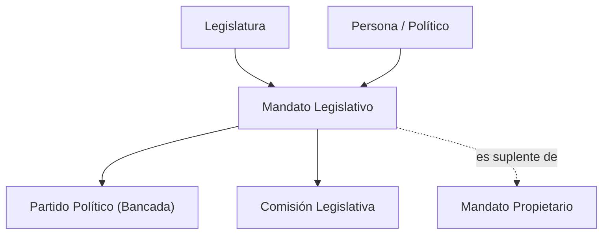
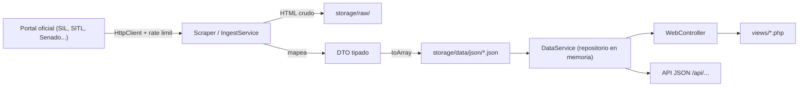

# Arquitectura de Pulso Cívico

## 1. Principios de Diseño
1. **Low-cost y Cero Dependencias Pesadas**: PHP 8.1+ vanilla, sin frameworks pesados (Laravel/Symfony), sin Composer ni npm obligatorios. Corre en cualquier hosting PHP estándar o en local con `php -S localhost:8000`.
2. **Datos Trazables y Neutrales**: Todo dato numérico o de filiación conserva su `fuente_url` oficial (`.gob.mx`), su `fecha_extraccion` y su hash SHA-256. Cero juicios, adjetivos subjetivos o propaganda partidista.
3. **Capas Separadas**: Las vistas nunca leen archivos ni llaman a portales externos directamente; todo pasa por DTOs tipados y servicios de datos.
4. **Grafo de Navegación Abierto**: Cada actor político y su contexto es un nodo hipervinculado bidireccionalmente.

---

## 2. Modelo de Negocio: Grafo Cívico y Desacoplamiento Persona vs. Mandato

La identidad de un actor político trasciende a una sola asamblea o legislatura. Para evitar duplicidades y permitir auditorías históricas, la plataforma desacopla la persona física de sus cargos temporales:

* **Entidad `politicos` (Persona Invariante):**  
  Representa a la persona física: nombre oficial, fotografía principal, semblanza curricular, escolaridad y slug SEO permanente (`/politicos/{slug}`).
* **Entidad `mandatos_legislativos` (Cargo Temporal en una Legislatura):**  
  Representa el ejercicio del cargo en un periodo determinado:
  - Cámara (Diputados / Senadores / Congreso Local) y Legislatura (ej. LXVI).
  - Grupo parlamentario o bancada (permite rastrear el **"Detector de Chapulines"** y cambios de partido).
  - Principio de elección (Mayoría Relativa, Representación Proporcional, Primera Minoría).
  - Entidad federativa y distrito electoral.
  - Rol de mandato: **Propietario** o **Suplente**. Si es suplente, enlaza al mandato titular que cubre (`titular_mandato_id`).

### Relaciones del Grafo:


---

## 3. Flujo de Datos



---

## 4. Estructura de Carpetas

```text
index.php            Front controller web (único punto de entrada)
config/config.php    Configuración (lee .env)
src/
  Core/              Router, HttpClient, Logger, ViewHelper
  Controllers/       WebController (rutas → vistas)
  DTO/               LegisladorDTO, VotacionDTO, SesionPlenoDTO (contratos de datos)
  Services/          DataService (lectura), SilIngestService y ParliamentScraperService (ingesta), EducationService (análisis)
views/               Plantillas PHP/HTML (layout/, partials/, páginas)
storage/
  data/json/         Datasets maestros en JSON (la "base de datos")
  raw/photos/        Fotos oficiales (únicas accesibles por HTTP dentro de storage)
  raw/html/          Descargas crudas de respaldo (no versionadas)
  logs/              Bitácoras de ejecución (no versionadas)
tools/
  gateway.php        CLI universal: php tools/gateway.php <accion>
  run.ps1            Atajo Windows hacia gateway.php
  core/              Linter, GitOps, Inspector, ScraperRouter
bin/console.php      CLI de ingesta
database/schema.sql  Modelo relacional de referencia (futuro, no usado en runtime)
```

---

## 5. Rutas Web Canónicas del Grafo

| Ruta | Descripción |
|---|---|
| `/` | Inicio + buscador global (`Ctrl+K`) + mapa político |
| `/politicos/{slug}` | Ficha integral del político, historial de mandatos, comisiones y votaciones |
| `/estados/{slug}` | Legisladores federales y locales clasificados por entidad |
| `/comisiones`, `/comisiones/{slug}` | Directorio e integración de comisiones con mesa directiva |
| `/partidos/{slug}` | Distribución de fuerzas, disciplina de bancada y cambios históricos |
| `/estudios`, `/estudios/{categoria}` | Estadísticas y análisis parlamentario |
| `/api/buscar`, `/api/estados/{slug}` | Endpoints de consulta JSON local |
| `/sitemap.xml` | Indexación SEO |

---

## 6. Requerimientos del Sistema (RF y RNF)

### Requerimientos Funcionales (RF)
* **RF-01 (Perfil Integral del Político):** Datos biográficos, contacto oficial, fotografía oficial y semáforos de actividad parlamentaria.
* **RF-02 (Red Bidireccional de Suplencias):** Enlace mutuo entre titular y suplente con detalle del periodo de asunción.
* **RF-03 (Navegación de Comisiones):** Detalle de integrantes clasificados por cargo (Presidente, Secretarios, Integrantes).
* **RF-04 (Línea de Tiempo de Bancadas / Chapulineo):** Registro cronológico de partidos a lo largo de legislaturas.
* **RF-05 (Auditoría Criptográfica):** Todo registro incluye `fuente_url` (`.gob.mx`) y hash SHA-256 de respaldo.
* **RF-06 (Búsqueda Rápida):** Búsqueda instantánea en cliente/servidor por nombre, estado, distrito o comisión.

### Requerimientos No Funcionales (RNF)
* **RNF-01 (Rendimiento Extremo):** Renderizado SSR en menos de 500 ms en redes móviles; consultas en memoria resueltas en <10 ms.
* **RNF-02 (Arquitectura Sin Dependencias):** PHP 8.1+ con `declare(strict_types=1);`, Bootstrap 5.3 vía CDN y JavaScript Vanilla nativo.
* **RNF-03 (SEO y Rich Snippets):** Metadatos OpenGraph para redes sociales y marcado estructurado Schema.org (`Person`, `GovernmentOrganization`).
* **RNF-04 (Blindaje de Neutralidad):** Cero juicios o descalificaciones. Solo datos oficiales trazables a portales gubernamentales.

---

## 7. Seguridad y Permisos
- `.htaccess` bloquea `src/`, `tools/`, `config/`, `storage/` (salvo fotos), dotfiles y logs.
- Toda salida en vistas se escapa con `ViewHelper::e()`.
- Configuración sensible solo en `.env` (nunca versionado en git).

---

## 8. Deuda Técnica Conocida (Buenas tareas para voluntarios)
- Archivos grandes por dividir: `SilIngestService.php`, `DataService.php`, `EducationService.php`, `views/politico.php`.
- Autoloader PSR-4 duplicado en varios archivos → centralizar en `src/bootstrap.php`.
- Falta `ScraperInterface` común para nuevas fuentes.
- Sin tests automatizados ni CI.
- `index.old.php` y `app.php` son legacy.
