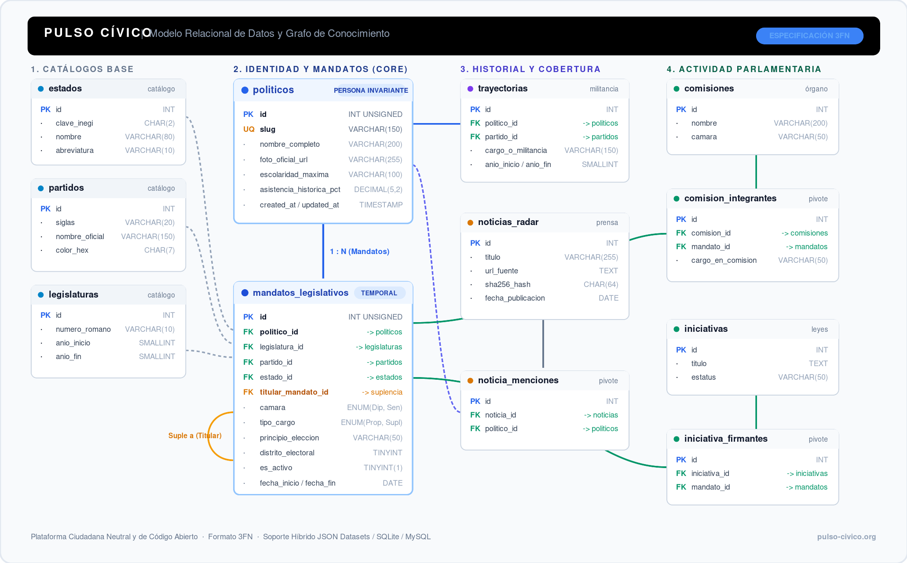

# DICCIONARIO DE DATOS Y ESPECIFICACIÓN DEL MODELO RELACIONAL
## Pulso Cívico — Plataforma de Transparencia Legislativa de México
**Versión:** 1.0 | **Motor:** MySQL 8.0 / MariaDB 10.11 | **Collation:** `utf8mb4_unicode_ci`

---

## 1. RESUMEN DEL MODELO
El modelo relacional implementa un **Grafo de Nodos y Vínculos** normalizado en 3FN para la integridad de datos, con contadores precalculados para garantizar tiempos de respuesta ultra-rápidos (<5 ms).

  

---

## 2. DICCIONARIO DE TABLAS

### 2.1 TABLA: `politicos` (Nodo Central: Persona Invariante en el Tiempo)
Representa a la persona física independientemente de las legislaturas en que participe.

| Columna | Tipo de Dato | Nulo | Descripción y Reglas de Negocio |
| :--- | :--- | :--- | :--- |
| `id` | `INT UNSIGNED AUTO_INCREMENT` | NO | Llave primaria artificial. |
| `slug` | `VARCHAR(150)` | NO | Identificador único para URLs SEO (ej. `fernando-jorge-castro-trenti`). Índice único. |
| `nombre_completo` | `VARCHAR(200)` | NO | Nombre oficial completo formateado. |
| `nombres` | `VARCHAR(100)` | SÍ | Nombre(s) de pila. |
| `apellido_paterno` | `VARCHAR(80)` | SÍ | Primer apellido. |
| `apellido_materno` | `VARCHAR(80)` | SÍ | Segundo apellido. |
| `fecha_nacimiento` | `DATE` | SÍ | Fecha de nacimiento en formato YYYY-MM-DD. |
| `genero` | `ENUM('M', 'F', 'OTRO')` | SÍ | Género para estadísticas de paridad. |
| `escolaridad_maxima`| `VARCHAR(100)` | SÍ | Grado máximo (Licenciatura, Maestría, Doctorado). |
| `preparacion_academica`| `TEXT` | SÍ | Descripción de carrera y universidad. |
| `foto_oficial_url` | `VARCHAR(255)` | SÍ | URL remota oficial del SIL. |
| `foto_local_path` | `VARCHAR(255)` | SÍ | Ruta relativa en el servidor (`/storage/raw/photos/{id}.jpg`). |
| `asistencia_historica_pct` | `DECIMAL(5,2)` | SÍ | Métrica precalculada de asistencia acumulada (0.00 a 100.00). |
| `leyes_aprobadas_total` | `SMALLINT UNSIGNED` | NO | Contador precalculado de iniciativas aprobadas. Default 0. |
| `created_at` | `TIMESTAMP DEFAULT CURRENT_TIMESTAMP` | NO | Registro de auditoría de creación. |
| `updated_at` | `TIMESTAMP ON UPDATE CURRENT_TIMESTAMP` | SÍ | Última actualización de datos. |

---

### 2.2 TABLA: `mandatos_legislativos` (Relación Persona ↔ Legislatura / Cargo Temporal)
Representa el periodo en que un político ocupa un escaño como **Propietario** o como **Suplente**.

| Columna | Tipo de Dato | Nulo | Descripción y Reglas de Negocio |
| :--- | :--- | :--- | :--- |
| `id` | `INT UNSIGNED AUTO_INCREMENT` | NO | Llave primaria del mandato. |
| `politico_id` | `INT UNSIGNED` | NO | FK a `politicos.id`. Político que ejerce el mandato. |
| `legislatura_id` | `SMALLINT UNSIGNED` | NO | FK a `legislaturas.id` (ej. 66). |
| `camara` | `ENUM('DIPUTADOS', 'SENADORES')` | NO | Cámara en la que actúa. |
| `partido_id` | `SMALLINT UNSIGNED` | NO | FK a `partidos.id`. Partido durante ESTA legislatura. |
| `estado_id` | `TINYINT UNSIGNED` | NO | FK a `estados.id`. Entidad federativa representada. |
| `distrito_federal` | `SMALLINT UNSIGNED` | SÍ | Número de distrito (NULL para Senadores o Plurinominales). |
| `principio_eleccion` | `ENUM('MAYORIA_RELATIVA', 'REPRESENTACION_PROPORCIONAL', 'PRIMERA_MINORIA')` | NO | Principio de asignación electoral. |
| `tipo_cargo` | `ENUM('PROPIETARIO', 'SUPLENTE')` | NO | **Regla clave:** Define si es titular o suplente. |
| `titular_mandato_id`| `INT UNSIGNED` | SÍ | **FK autorreferencial a `mandatos_legislativos.id`.** Si este registro es `SUPLENTE`, apunta al mandato del propietario a quien suple. Si es `PROPIETARIO`, es NULL. |
| `estatus` | `ENUM('EN_FUNCIONES', 'CON_LICENCIA', 'BAJA', 'SUPLENTE_EN_ESPERA')` | NO | Estatus operativo del cargo. |
| `referencia_sil` | `VARCHAR(20)` | SÍ | ID del SIL SEGOB correspondiente a este periodo. |
| `correo_institucional` | `VARCHAR(120)` | SÍ | Correo en `@diputados.gob.mx` o `@senado.gob.mx`. |
| `telefono_oficina` | `VARCHAR(80)` | SÍ | Teléfono y extensión oficial. |
| `ubicacion_oficina` | `VARCHAR(150)` | SÍ | Edificio, piso y oficina en el recinto legislativo. |
| `fecha_inicio` | `DATE` | SÍ | Fecha de toma de protesta (ej. 2024-08-29). |
| `fecha_fin` | `DATE` | SÍ | Fecha de conclusión de periodo (ej. 2027-08-31). |

---

### 2.3 TABLA: `comisiones` (Nodo: Comisiones Legislativas)
Representa las comisiones de trabajo ordinarias, especiales y bicamarales.

| Columna | Tipo de Dato | Nulo | Descripción |
| :--- | :--- | :--- | :--- |
| `id` | `INT UNSIGNED AUTO_INCREMENT` | NO | Llave primaria. |
| `legislatura_id` | `SMALLINT UNSIGNED` | NO | FK a `legislaturas.id`. |
| `camara` | `ENUM('DIPUTADOS', 'SENADORES', 'CONGRESO_UNION')` | NO | Instancia parlamentaria. |
| `nombre` | `VARCHAR(200)` | NO | Nombre oficial (ej. `Hacienda y Crédito Público`). |
| `slug` | `VARCHAR(220)` | NO | Slug para URL (`/comision/hacienda-y-credito-publico-diputados`). |
| `tipo` | `ENUM('ORDINARIA', 'ESPECIAL', 'BICAMARAL', 'COMITE')` | NO | Clasificación reglamentaria. |

---

### 2.4 TABLA: `comision_integrantes` (Arista: Mandato ↔ Comisión)
Vincula a los legisladores con las comisiones asignadas durante su mandato.

| Columna | Tipo de Dato | Nulo | Descripción |
| :--- | :--- | :--- | :--- |
| `id` | `INT UNSIGNED AUTO_INCREMENT` | NO | Llave primaria. |
| `comision_id` | `INT UNSIGNED` | NO | FK a `comisiones.id`. |
| `mandato_id` | `INT UNSIGNED` | NO | FK a `mandatos_legislativos.id`. |
| `puesto` | `ENUM('PRESIDENTE', 'SECRETARIO', 'INTEGRANTE')` | NO | Cargo en la mesa de la comisión. |
| `fecha_inicio` | `DATE` | SÍ | Fecha de designación oficial. |
| `fecha_fin` | `DATE` | SÍ | Fecha de baja o relevo. |
| `estatus` | `ENUM('ACTIVO', 'BAJA')` | NO | Estatus en la comisión. Default 'ACTIVO'. |

---

### 2.5 TABLA: `trayectorias` (Línea de Tiempo y Detector de Chapulines)
Registra el historial político, administrativo, legislativo y escolar extraído de fuentes oficiales.

| Columna | Tipo de Dato | Nulo | Descripción |
| :--- | :--- | :--- | :--- |
| `id` | `INT UNSIGNED AUTO_INCREMENT` | NO | Llave primaria. |
| `politico_id` | `INT UNSIGNED` | NO | FK a `politicos.id`. |
| `tipo` | `ENUM('POLITICA', 'LEGISLATIVA', 'ADMINISTRATIVA', 'ACADEMICA', 'OTRO')` | NO | Categoría de la trayectoria. |
| `del_ano` | `SMALLINT UNSIGNED` | SÍ | Año inicial del cargo (ej. 2013). |
| `al_ano` | `SMALLINT UNSIGNED` | SÍ | Año final del cargo (ej. 2015). |
| `cargo_experiencia` | `TEXT` | NO | Descripción oficial del cargo. |

---

### 2.6 TABLA: `iniciativas` (Iniciativas de Ley y Puntos de Acuerdo)
| Columna | Tipo de Dato | Nulo | Descripción |
| :--- | :--- | :--- | :--- |
| `id` | `INT UNSIGNED AUTO_INCREMENT` | NO | Llave primaria. |
| `legislatura_id` | `SMALLINT UNSIGNED` | NO | FK a `legislaturas.id`. |
| `camara` | `ENUM('DIPUTADOS', 'SENADORES')` | NO | Cámara de origen. |
| `tipo` | `ENUM('LEY_NUEVA', 'REFORMA_CONSTITUCIONAL', 'REFORMA_LEGAL', 'PUNTO_ACUERDO')` | NO | Tipo de iniciativa. |
| `titulo` | `TEXT` | NO | Título oficial de la iniciativa. |
| `estatus` | `ENUM('APROBADA', 'PENDIENTE', 'DESECHADA', 'RETIRADA')` | NO | Estatus legislativo. |
| `fecha_presentacion`| `DATE` | NO | Fecha de presentación ante el pleno. |
| `referencia_sil` | `VARCHAR(30)` | SÍ | ID de asunto en el SIL. |

---

### 2.7 TABLA: `iniciativa_firmantes` (Grafo de Co-Firmantes / Alianzas Cruzadas)
| Columna | Tipo de Dato | Nulo | Descripción |
| :--- | :--- | :--- | :--- |
| `id` | `INT UNSIGNED AUTO_INCREMENT` | NO | Llave primaria. |
| `iniciativa_id` | `INT UNSIGNED` | NO | FK a `iniciativas.id`. |
| `mandato_id` | `INT UNSIGNED` | NO | FK a `mandatos_legislativos.id`. |
| `rol` | `ENUM('INICIANTE', 'COFIPROPIETARIO', 'ADHERENTE')` | NO | Tipo de participación. |

---

### 2.8 TABLAS DE CATÁLOGO ESTÁTICO
* `estados`: (id, nombre, slug, abreviatura, senadores_total=3, diputados_distritos_total).
* `partidos`: (id, sigla, nombre_completo, slug, color_primario_hex, color_secundario_hex, logo_path).
* `legislaturas`: (id, numero_romano, inicio_ano, fin_ano, slug, es_actual).
