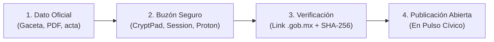

# 📥 Guía de Colaboración sin Programar: Buzón de Staging

> **¿Eres periodista, investigador, estudiante o ciudadano y tienes datos oficiales?**  
> No necesitas saber programar, usar la terminal ni tener cuenta en GitHub para colaborar. Este documento explica cómo enviarnos información de forma sencilla, segura e incluso completamente anónima.

---

## 1. ¿Qué es el "Buzón de Staging"?

El **Staging** es un área de recepción y revisión intermedia:
1. Tú nos compartes los datos oficiales, gacetas o documentos que encontraste.
2. Nuestro equipo y herramientas automáticas revisan que la liga oficial funcione (`.gob.mx`), calculan su huella digital criptográfica (SHA-256) y guardan una copia permanente en la Wayback Machine para que nunca se pierda.
3. Una vez verificado, los datos se publican en el repositorio abierto de Pulso Cívico para que cualquier ciudadano pueda consultarlos.

---

## 2. ¿Qué información necesitamos? (Checklist básico)

Para que un dato pueda ser publicado, solo requerimos estos 3 elementos:

| Requisito | Descripción | Ejemplo |
|---|---|---|
| **1. Identificación** | Nombre de la persona, cargo y entidad federativa. | *"Dip. Juan Pérez, Congreso de Jalisco (LXVI)"* |
| **2. Enlace Oficial** | URL al portal del Congreso, gaceta `.gob.mx` o nota de prensa acreditada. | `https://congresojal.gob.mx/gaceta/...` |
| **3. Evidencia (Opcional)** | PDF, captura o documento oficial por si el portal del gobierno se cae. | Archivo adjunto o captura de pantalla |

---

## 3. Canales de Envío (Tabla Comparativa de Privacidad y Anonimato)

| Nivel de Privacidad | Canal Recomendado | ¿Pide Cuenta / Teléfono? | Tipo de Seguridad | Ideal para... |
|---|---|---|---|---|
| 🟢 **Rápido y Sin Registro** | **[CryptPad.fr](https://cryptpad.fr)** / Pastebin cifrado | ❌ Cero cuentas ni registros | Cifrado en tu navegador | Tablas de legisladores, listas de links y notas |
| 🟡 **Mensajería P2P Segura** | **Session** / SimpleX Chat | ❌ Sin teléfono ni correo | ID criptográfico descentralizado | Enviar archivos, PDFs de gacetas, capturas |
| 🔴 **Máxima Protección** | **ProtonMail / Tuta** (+ Tor Browser) | ⚠️ Cuenta anónima desechable | Cifrado de extremo a extremo + IP oculta | Periodistas, filtraciones e informantes clave |
| ⚪ **Público (con crédito)** | **GitHub Issues** | ✔️ Requiere usuario de GitHub | Registro público en tu perfil | Colaboradores y programadores habituales |

### Detalles de uso según el canal elegido:
* **Si usas CryptPad:** Abre un bloc o calc en [CryptPad.fr](https://cryptpad.fr) sin iniciar sesión, pega tus datos y compártenos el enlace en modo lectura.
* **Si usas Session:** Descarga la app en tu móvil o PC, no ingreses número ni correo; genera un ID anónimo y comunícate con nosotros.
* **Si usas Correo Cifrado:** Abre una cuenta gratuita en [Proton.me](https://proton.me) o [Tuta.com](https://tuta.com) en 2 minutos sin datos personales y escríbenos directamente.
* **Si usas Tor Browser:** Utilízalo para abrir cualquiera de los enlaces anteriores si necesitas ocultar totalmente tu dirección IP y ubicación física.

---

## 4. Consejos de Seguridad para Quienes Aportan Evidencia

Si manejas información sensible o documentos internos que son de interés público:
1. **Limpia los metadatos de los archivos:** Las fotos y PDFs guardan información oculta (marca de cámara, coordenadas GPS, usuario de Word). Puedes usar herramientas gratuitas y libres como **Metadata Cleaner** o **MAT2** antes de enviar un archivo.
2. **No uses redes laborales:** Nunca envíes datos desde computadoras de oficinas gubernamentales ni redes Wi-Fi institucionales.
3. **Pulso Cívico nunca solicita datos personales:** Jamás te pediremos tu nombre real, credencial ni número telefónico para recibir información pública verificable.
