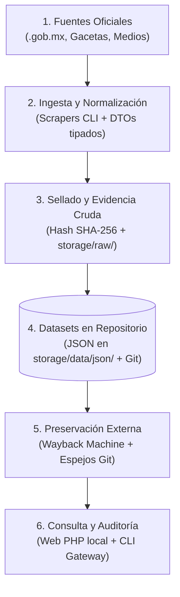
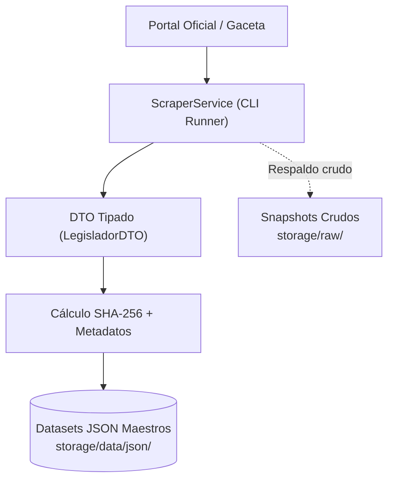
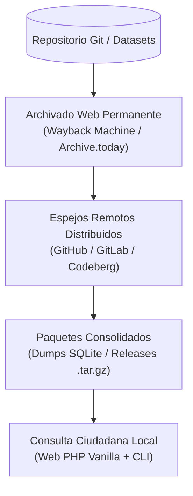

# Estrategia de Preservación Digital e Integridad de Datos

Este documento define las directrices del **repositorio Pulso Cívico** para garantizar la perdurabilidad histórica, la verificación criptográfica y la distribución abierta de los datos públicos legislativos frente a problemas comunes de disponibilidad (rediseños de portales oficiales, enlaces rotos, purgas de legislaturas pasadas o caídas de servidores gubernamentales).

---

## 1. Propósito y Principios del Repositorio

1. **Disponibilidad Histórica Permanente:**  
   Los portales oficiales de los congresos locales y federales suelen cambiar de estructura o eliminar historiales al concluir cada legislatura. Este repositorio actúa como un archivo cívico estructurado que conserva los registros en formatos abiertos (JSON).
2. **Verificabilidad Criptográfica de Evidencia:**  
   Cada registro extraído en el repositorio vincula su `fuente_url` oficial (`.gob.mx`), su `fecha_extraccion` y una huella digital matemática (hash SHA-256). Esto permite demostrar de manera objetiva que la información no ha sido alterada ni inventada.
3. **Descentralización y Portabilidad:**  
   Al mantener los datos en archivos planos JSON dentro del árbol de control de versiones de Git, cualquier ciudadano, medio periodístico o institución académica puede clonar el repositorio completo y consultar la base de datos sin depender de un servidor central ni de infraestructura compleja.
4. **Neutralidad Documental:**  
   El repositorio recopila y organiza datos públicos oficiales y notas periodísticas acreditadas. No emite juicios de valor, opiniones ni adjetivos; su valor radica en la trazabilidad verificable del historial de cada legislador.

---

## 2. Arquitectura de Flujo e Integridad

Para facilitar la visualización en consolas, navegadores y terminales de texto, la arquitectura se divide en un flujo general vertical compacto y dos módulos de detalle.

### 2.1 Flujo General del Repositorio (Vista Integral)

### 2.2 Desglose Modular

#### Módulo A: Ingesta y Sellado Local de Datos

#### Módulo B: Preservación, Espejos y Distribución

---

## 3. Plan de Implementación por Fases

### FASE 1: Integridad Criptográfica Local y Trazabilidad Git (Fase Actual)
*Objetivo: Que los datasets del repositorio cuenten con verificación criptográfica y trazabilidad directa a su fuente oficial.*

* [ ] **Paso 1.1: Metadatos estándar en datasets JSON**  
  Asegurar que cada registro en `storage/data/json/` cuente con:
  - `fuente_url`: Enlace directo al portal oficial `.gob.mx` o documento original.
  - `fecha_extraccion`: Marca temporal ISO-8601 del momento de captura.
  - `sha256`: Hash criptográfico del contenido o archivo original de respaldo.
* [ ] **Paso 1.2: Auditoría automatizada en el CLI**  
  Ampliar las herramientas internas (`php tools/gateway.php health`) para auditar la presencia de fuentes oficiales y alertar sobre registros huérfanos o sin hash.
* [ ] **Paso 1.3: Redacción neutral tipo archivo documental**  
  Mantener en las plantillas del repositorio el estándar de presentación objetiva:
  > *"Registro obtenido del portal oficial de [Institución] con fecha de extracción [Fecha]. Pulso Cívico preserva copias de datos públicos para consulta y auditoría ciudadana."*

---

### FASE 2: Archivado Web y Enlaces Permanentes
*Objetivo: Prevenir que la pérdida o rediseño de un portal gubernamental invalide la fuente de un dato en el repositorio.*

* [ ] **Paso 2.1: Instantáneas automáticas en servicios de archivo público**  
  Integrar en los scripts de ingesta la solicitud de archivado a servicios abiertos como:
  - Wayback Machine (Internet Archive API).
  - Archive.today.
* [ ] **Paso 2.2: Campo `archive_url` complementario**  
  Registrar junto a `fuente_url` el enlace al snapshot permanente generado, garantizando que el usuario siempre pueda consultar el estado del portal oficial a la fecha de extracción.
* [ ] **Paso 2.3: Visor de verificación en la interfaz web**  
  En las vistas de perfil y votaciones, ofrecer enlaces directos tanto a la fuente oficial activa como a su respaldo permanente archivado.

---

### FASE 3: Distribución Descentralizada y Respaldos Abiertos
*Objetivo: Garantizar que la base de datos completa del repositorio sea fácil de replicar y descargar por la sociedad civil.*

* [ ] **Paso 3.1: Espejos múltiples del repositorio Git**  
  Configurar remotos sincronizados en plataformas como GitHub, GitLab o instancias comunitarias (Codeberg), eliminando puntos únicos de falla para el código y los datasets.
* [ ] **Paso 3.2: Exportaciones periódicas en paquetes consolidados (Releases)**  
  Generar periódicamente compilaciones descargables en un archivo único de SQLite (`storage/database.sqlite`) o archivos comprimidos `.tar.gz` para que periodistas e investigadores puedan trabajar sin conexión.
* [ ] **Paso 3.3: Almacenamiento descentralizado para documentos pesados (IPFS / Arweave)**  
  Para documentos oficiales de gran volumen (gacetas parlamentarias completas, dictámenes escaneados o videos de sesiones), almacenar copias estáticas en redes como IPFS o Arweave, referenciando su identificador de contenido (CID) en los metadatos del repositorio.

---

### FASE 4: Privacidad y Acceso Comunitario
*Objetivo: Facilitar la consulta y auditoría de los datos con total respeto a la privacidad de los usuarios.*

* [ ] **Paso 4.1: Privacidad por diseño (Zero Logs)**  
  No recopilar datos personales, cuentas de usuario ni direcciones IP de quienes consultan el repositorio o sus instancias web.
* [ ] **Paso 4.2: Facilidad de despliegue local**  
  Conservar la política de cero dependencias externas pesadas, permitiendo que cualquier persona ejecute una réplica local completa con el servidor integrado de PHP (`php -S localhost:8000`).
* [ ] **Paso 4.3: Colaboración con organizaciones civiles**  
  Poner a disposición de colectivos de transparencia, redes de periodistas y observatorios legislativos los métodos de verificación e integridad desarrollados en este repositorio.
